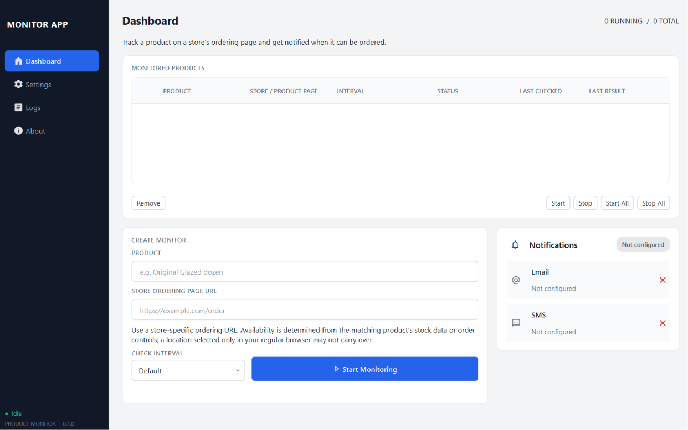
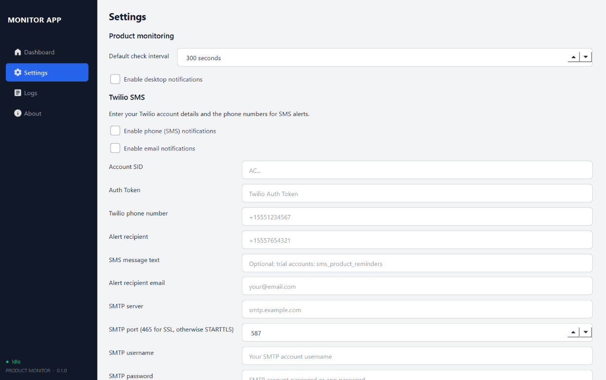
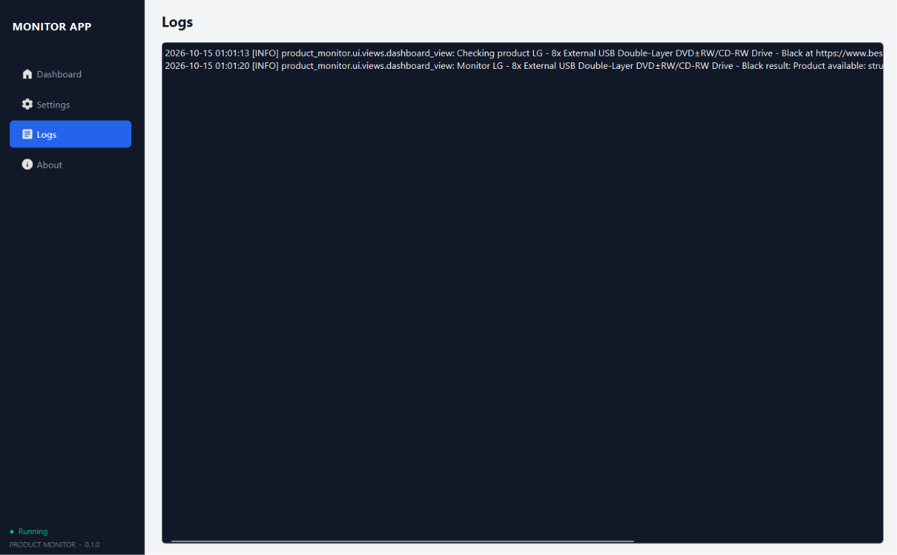
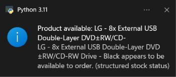
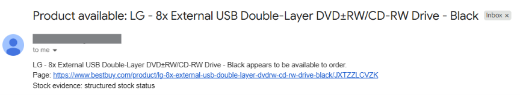

# Product Availability Monitor

[](https://github.com/seal-000/product-availability-monitor/actions/workflows/tests.yml)

## 📋 Table of Contents

- [Project overview](#project-overview)
- [Features](#features)
- [Engineering decisions](#engineering-decisions)
- [Availability detection: evidence and limits](#availability-detection-evidence-and-limits)
- [Demo](#demo)
- [Screenshots](#screenshots)
- [Project structure](#project-structure)
- [Requirements](#requirements)
- [Installation](#installation)
- [Running the app](#running-the-app)
- [Configuration](#configuration)
- [Testing](#testing)
- [Notes](#notes)

## Project overview

Product Availability Monitor is a desktop app for tracking whether a product is available on a retailer or product page and alerting you when availability changes.

It is built with Python, PyQt6, and Selenium, and it can monitor product pages, detect availability signals, and send desktop, SMS, or email notifications.

## Features

- Monitor one or more product pages for stock status
- Browser-based checks using Selenium
- Availability detection from storefront HTML content
- Configurable polling interval
- Desktop notifications
- Twilio SMS notifications
- SMTP email notifications
- Secure credential storage via the OS keyring
- Local app settings persisted with Qt settings

## Engineering decisions

- **Keep the UI responsive:** Selenium checks and notification delivery run in
  `QThreadPool` workers, with a maximum of three workers at a time. Qt signals
  return results to the UI, and a monitor is not checked again while its prior
  check is still in flight.
- **Alert on availability changes, not every poll:** The app remembers each
  monitor's last result in memory and sends alerts when a check reports
  available after a non-available result. Repeated available checks do not send
  duplicate alerts; an unavailable or unknown result allows a later available
  result to alert again. This state is not persisted, so restarting the app can
  cause an alert on the first available check. Failed alerts are shown and
  logged, but are not automatically retried while the product remains
  available.
- **Separate preferences from secrets:** Qt `QSettings` stores notification
  preferences, provider details, polling interval, and monitor definitions.
  Twilio and SMTP passwords are stored in the operating system keyring.
  Environment variables can supply fallback values. If the keyring cannot be
  accessed while saving, the UI reports the problem and does not save those
  settings.
- **Make failures visible and keep checking:** Browser or unexpected check
  failures are logged and reported as an unknown/error result instead of being
  treated as out of stock. Handled notification delivery errors are returned
  per channel, displayed with the monitor result, and logged; the other enabled
  channel is still attempted.

The worker, alert-transition, delivery-failure, and credential-storage
behaviors are covered in [`tests/test_dashboard_view.py`](tests/test_dashboard_view.py)
and [`tests/test_settings_view.py`](tests/test_settings_view.py).

## Availability detection: evidence and limits

The detector analyzes the page HTML returned by Selenium and reports a status
only when it finds stock evidence associated with the requested product. It
supports:

- Matching `Product` JSON-LD structured data with recognized Schema.org
  availability values, such as `InStock` and `OutOfStock`
- A matching product card or item container with a stock-status attribute,
  unavailable wording (for example, “Sold out”), or an enabled purchase action
  (for example, “Add to cart” or “Customize”)
- A single-product page with one matching `<h1>` and a recognizable purchase
  control outside a product card

| Representative page evidence | Result | Automated example |
| --- | --- | --- |
| Matching product JSON-LD offer says `InStock` | Available | `test_structured_product_stock_status_matches_the_named_product` |
| Matching product card says “Sold out” | Unavailable | `test_krispy_kreme_out_of_stock_badge_takes_precedence_over_disabled_order_button` |
| Matching product card has an enabled “Add to order” button | Available | `test_product_card_checks_only_the_matching_item` |
| Product is found, but only a disabled purchase control is present | Unknown | `test_unrelated_available_text_does_not_mark_product_available` |
| Requested product cannot be identified on the page | Unknown | `test_page_without_the_named_product_is_unknown` |

These cases are covered in [`tests/test_detector.py`](tests/test_detector.py).
“Unknown” is intentional: general page text like “available today” is not
enough to establish that the requested item is in stock. The detector can also
return unknown when the product or its stock signal is missing from the fetched
HTML, when the storefront uses markup or wording it does not recognize, or
when the page requires a pickup location before showing inventory.

This is a general HTML-based detector, not a retailer-specific integration.
Storefront markup, localization, variants, and inventory rules differ, so a
recognized signal is not a guarantee that checkout will succeed. Check the
result against the store page; some sites may need a selected store or a
different ordering URL.

## Screenshots

### Dashboard

Add a product name and store URL, then start monitoring.



### Settings

Configure the check interval and desktop, SMS, and email notifications.



### Logs

Review recent checks and results.



### Desktop notification

Shown as a system tray toast when a monitored product becomes available.



### Email notification

Sent through SMTP with the product name, page link, and stock evidence.



## Demo

[Watch the app demo recording](docs/recording.mp4)

## Project structure

- `src/product_monitor/` – application logic
- `src/product_monitor/ui/` – PyQt interface and widgets
- `tests/` – automated tests
- `docs/screenshots/` – README images
- `run_app.py` – application entry point

## Requirements

- Python 3.11+
- Chrome or Chromium installed with a matching ChromeDriver available to Selenium
- Optional: Twilio account and/or SMTP server for notifications

## Installation

1. Clone the repository.
2. Create and activate a virtual environment:

```bash
python -m venv .venv
# Windows PowerShell
.\.venv\Scripts\Activate.ps1
# macOS/Linux
source .venv/bin/activate
```

3. Install the project and test dependencies:

```bash
pip install -e .[test]
```

## Running the app

Start the desktop application with either of the following:

```bash
python run_app.py
```

or

```bash
python -m product_monitor.ui
```

## Configuration

You can configure the app in the UI under Settings.

The app also supports environment variables as fallbacks for notification settings, including:

- `TWILIO_ACCOUNT_SID`
- `TWILIO_AUTH_TOKEN`
- `TWILIO_FROM_PHONE_NUMBER`
- `TWILIO_TO_PHONE_NUMBER`
- `TWILIO_SMS_BODY`
- `SMTP_HOST`
- `SMTP_PORT`
- `SMTP_USERNAME`
- `SMTP_PASSWORD`
- `EMAIL_FROM`
- `TO_EMAIL`
- `DEFAULT_INTERVAL_SECONDS`

Credentials entered in the app are stored in the operating system keyring when available.

## Testing

Run the test suite with:

```bash
pytest
```

## Notes

This project is designed for monitoring product availability on storefront pages and alerting you when items become available again. Check the code and tests for the precise product detection logic and notification behavior used by your specific setup.
